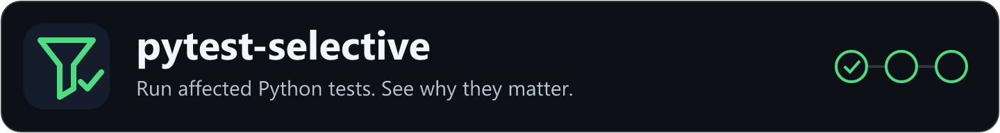

# pytest-selective
[](https://github.com/gigaverse-app/pytest-selective/actions/workflows/ci.yml)
[](https://pypi.org/project/pytest-selective/)
[](https://github.com/gigaverse-app/pytest-selective/blob/main/pyproject.toml)
[](https://github.com/gigaverse-app/pytest-selective/blob/main/src/pytest_selective/py.typed)
[](https://github.com/gigaverse-app/pytest-selective/blob/main/.pre-commit-config.yaml)
[](https://github.com/gigaverse-app/pytest-selective/blob/main/LICENSE)
[](https://github.com/gigaverse-app/pytest-selective/blob/main/docs/agents.md)
[](https://pytest-selective.readthedocs.io/en/latest/)

**Run affected Python tests. See why they matter.**

**Set it up with your coding agent.** Paste this one prompt into Claude Code, Codex, Cursor or any coding agent in
your repository:

```text
Set up pytest-selective in this repository. Fetch https://pytest-selective.readthedocs.io/en/latest/agent-setup.md and follow it.
```

The agent maps your CI jobs to lanes, adds the planner, a gate and routing tests, proves a docs-only pull request skips the expensive jobs while code changes keep full coverage, measures the difference and opens a pull request. Making the gate a required check, labels and merging stay with you. [Read the procedure it follows](https://pytest-selective.readthedocs.io/en/latest/agent-setup/).

[Read the documentation](https://pytest-selective.readthedocs.io/en/latest/) · [Related tools](https://pytest-selective.readthedocs.io/en/latest/ecosystem/)

pytest-selective is a **Python test impact analysis** tool for incremental testing
with pytest. It follows dependencies through both sides of a Git change, selects
the affected test files, and explains the result. Use it directly as a pytest
plugin, or plan before collection and service startup with the CLI and CI actions.

Built from the selector used in Gigaverse's backend, AI, and shared Python
infrastructure. Use the actions at the moving `@v1` tag, which follows the newest
release, and the package at `pytest-selective>=X.Y.Z,<2`. Where your tooling rejects
tags, pin both to one release instead: `@<sha> # vX.Y.Z` and `pytest-selective==X.Y.Z`.
[Provenance and extraction scope](https://github.com/gigaverse-app/pytest-selective/blob/main/PROVENANCE.md).

[Quick tutorial](https://github.com/gigaverse-app/pytest-selective/blob/main/docs/tutorial.md) ·
[Adoption guide](https://github.com/gigaverse-app/pytest-selective/blob/main/docs/configuration.md) ·
[GitHub Actions](https://github.com/gigaverse-app/pytest-selective/blob/main/docs/ci.md) ·
[Evidence and limits](https://github.com/gigaverse-app/pytest-selective/blob/main/docs/evidence.md) ·
[Keep selection narrow](docs/pytest-hygiene.md)

[Run local edits before committing](docs/local-development.md) ·
[Comparison with pytest-impacted](docs/comparison-pytest-impacted.md)

CI-esta now uses this selector in its own CI: a matched README-only pair
used **49 instead of 105 runner-seconds (53.3% less)** while keeping quality,
routing and package checks. Its reports now compute dependency critical paths
and slack. [See the source runs and method](https://github.com/gigaverse-app/ci-esta/blob/main/docs/benchmarks/2026-10-23-toolkit.md).

## Choose how to use it

Follow the [adoption tutorial and checklist](docs/tutorials/adoption-checklist.md)
for local execution, CI routing, dependency audits, timing feedback and measured rollout.

| You want to… | Use | What it saves |
| --- | --- | --- |
| Test local edits with your existing pytest command | `uv add --dev pytest-selective`, then `uv run pytest --selective` | Unaffected test execution; staged, unstaged and untracked changes are included |
| Avoid expensive collection and application imports | `pytest-selective run --config .github/test-impact.json -- -q` | Collection/imports for unaffected files as well as execution |
| Plan affected files in GitHub Actions | `gigaverse-app/pytest-selective@v1` | Plans before installing your application |
| Keep whole-suite coverage or conformance checks | `gigaverse-app/pytest-selective/actions/plan-lanes@v1` | Entire unaffected jobs, including their services and setup |
| Check assumptions about JSON, templates and other runtime inputs | Optional file-read recorder and dependency audit | Exposes observed reads missing from the declared graph |
| Keep selection narrow as the project grows | Explanations, startup-floor budgets, expansion and isolation guards | Makes broad new fixture/import dependencies visible |

Start with [local pytest](docs/local-development.md), [the complete CI recipe](docs/ci.md),
or [dependency audits and hygiene](docs/selection-health.md). The native plugin
collects normally; the pre-collection runner and CI planner can avoid that cost.
Keep full checkpoints and use complete lanes when partial suites cannot satisfy
your coverage contract.

**Public-path availability:** version 1 provides the root action and
`actions/NAME` paths. Use the moving `@v1` tag for compatible updates.
Older immutable releases retain their original layouts.
[Public action API](docs/actions.md).

## Have your agent set it up

The one-prompt setup above fetches the [agent setup procedure](https://pytest-selective.readthedocs.io/en/latest/agent-setup.md),
which is the repository's [agent skill](skills/pytest-selective/SKILL.md) published verbatim.
[Install the skill or add AGENTS.md instructions](https://github.com/gigaverse-app/pytest-selective/blob/main/docs/agents.md).
Works through existing Git/CLI tools; no new agent server is needed.

## A small change should have an explainable test plan

```text
shop/prices.py changed
    └── shop/checkout.py imports prices
            └── tests/test_checkout.py       RUN
                tests/test_health.py         unaffected
                tests/test_labels.py         unaffected

Shared conftest changed?                     RUN ALL THREE
Only the unreferenced README changed?        SKIP PYTEST
```

The [executable tutorial](https://github.com/gigaverse-app/pytest-selective/blob/main/scripts/tutorial.py)
creates real commits, introduces a pricing regression, and runs pytest on the
selected files. One of three files is selected and catches the regression.
This is a reproducible selection example, **not a wall-time speedup claim**.

## Used by Due and pytest-obligation

[Due](https://github.com/gigaverse-app/due) and
[pytest-obligation](https://github.com/gigaverse-app/pytest-obligation) plan every
pull request with pytest-selective. Their conformance suites need PostgreSQL,
Redis, Celery workers and real framework checkouts, so skipping an unaffected
**lane** saves minutes. Measured on real GitHub Actions runs:

| Change | Full CI | Selective CI | Runner-seconds |
| --- | ---: | ---: | ---: |
| Due: one library test | 6m03s | **3m24s** | 747 → 388 (−48%) |
| pytest-obligation: one MongoDB test | 5m22s | **54s** | 1,602 → 93 (−94%) |
| pytest-obligation: package README | 6m03s | **20s** | 1,691 → 57 (−97%) |
| pytest-selective itself: README | 3m31s | **26s** | 627 → 48 (−92%) |

Each row is one successful pair on the same PR head and merge checkout: the
selective run first, then a `test:full` control. Both include planning time.
Single observations, not billed minutes or a promise for every PR. An affected
lane still runs complete, with its conformance evidence checks. A Due docs-only
PR also finished in 26s (91 runner-seconds), an observed run without a paired
control ([docs-routing evidence](https://github.com/gigaverse-app/pytest-selective/blob/main/docs/benchmarks/2026-10-22-routing.md)).

Adoption: [Due #68](https://github.com/gigaverse-app/due/pull/68) and
[pytest-obligation #93](https://github.com/gigaverse-app/pytest-obligation/pull/93),
each with its own lane map (`.github/test-lanes.json`).
[Run links, raw timestamps, method and limits](https://github.com/gigaverse-app/pytest-selective/blob/main/docs/benchmarks/2026-10-22.md),
including Due's widget benchmark, which selection skips entirely.

## Try it in two minutes

Install the plugin in your test environment, then use ordinary pytest:

```bash
uv add --dev pytest-selective
uv run pytest --selective
uv run pytest --selective --selective-base origin/main -n auto
uv run pytest --no-selective
```

Selection is opt-in. The default compares HEAD with staged, unstaged and
nonignored untracked files. `--selective-base` compares against the exact ref
you supply, including local edits. The plugin reuses the CLI's dependency graph,
deselects unaffected collected tests, and keeps doctests and unknown collectors.
Normal test paths, node IDs, `-k` and `-m` still apply. Missing history runs the
complete requested suite. [Plugin configuration and limits](docs/local-development.md).

For pre-collection selection, use `pytest-selective run`; for CI jobs with
expensive setup or whole-suite evidence requirements, use lane selection.

Requires **Python 3.11+ and Git 2.24+**. The examples use uv; the native plugin
also works in your existing pytest environment. Use a planner Python version at
least as new as your source syntax; the CI action uses Python 3.14. Your test
runtime can use a different Python version when planning runs separately.
The optional audit recorder requires Python 3.11+ in the test environment.

```bash
git clone https://github.com/gigaverse-app/pytest-selective.git
cd pytest-selective
uv sync --locked
uv run python scripts/tutorial.py --output tutorial-report.json
```

```text
transitive regression: scoped, 1/3 files; pytest exit 1 (expected)
documentation only: none, 0/3 files; pytest skipped
shared conftest: full, 3/3 files; pytest exit 1 (expected)
```

The nonzero pytest results are intentional: they prove the selected tests catch
the introduced bug. The tutorial itself succeeds only when all expected outcomes
hold. It uses a temporary repository and leaves your checkout untouched.

## Install in your project

Install from PyPI using Python 3.11+:

```bash
pip install "pytest-selective>=1,<2"
```

For source development, GitHub installation is also available:

```bash
pip install "pytest-selective @ git+https://github.com/gigaverse-app/pytest-selective.git"
```

Use compatible package ranges; lockfiles retain exact resolved artifacts.
For action-path availability and release pins, see [the action API](docs/actions.md). Then follow the
[configuration walkthrough](https://github.com/gigaverse-app/pytest-selective/blob/main/docs/configuration.md)
to declare module roots, test roots, collection-policy fingerprints, and non-Python inputs.

```bash
pytest-selective affected --config .github/test-impact.json \
  --base origin/main --head HEAD --output selection.json \
  --explanation-output explanation.json
```

`affected` reads **committed Git trees** by default. Use `affected --working-tree`
or `pytest-selective run` to include uncommitted edits.
The report distinguishes `scoped`, `full`, and `none`; an empty selection must
skip pytest, because invoking pytest without paths runs the whole suite.

## Why pytest-selective?

| When your change touches… | The planner accounts for… |
| --- | --- |
| A transitive dependency | Import chains and package initialization |
| A deleted or renamed module | Dependencies in both the base and head trees |
| Fixtures or startup code | Ancestor conftests, plugins named by `-p` in `addopts`, the project's own `pytest11` entry points, and configured global modules |
| Templates, schemas, or data files | [Reader-owned declarations and YAML sidecars](docs/tutorials/sidecar-dependencies.md) |
| A surprisingly large selection | Dependency paths, startup-floor and blast-radius explanations |
| A large CI suite | Cached parsing, graph reuse, and duration-based shard planning |
| Undeclared runtime reads | An opt-in pytest recorder and audit command |

The CLI emits JSON for your runner. The
[composite action](https://github.com/gigaverse-app/pytest-selective/blob/main/test-impact/action.yml)
adds caching and falls back to complete test roots on operational planning
failures. Invalid dependency declarations fail with a diagnostic that must be fixed.

## What a green run means

Selection is only as complete as the dependency model. Static analysis cannot
discover every dynamic import, plugin registration, environment dependency, or
file read. Declare those edges, audit representative runs, and keep full-suite
checkpoints. A green selected run is not proof that every test would pass.

Selection chooses **which files are affected**; your existing markers and CI
policy still determine which tests may run. Suites that enforce complete
collection or whole-suite coverage need full runs.

For expensive suites that must retain complete conformance evidence, use
[whole-lane selection](https://github.com/gigaverse-app/pytest-selective/blob/main/docs/ci.md#select-whole-ci-lanes).
An affected test activates its entire lane, preserving the lane's existing tests
and evidence checks.

[Read the evidence, safety boundaries, and adoption checklist](https://github.com/gigaverse-app/pytest-selective/blob/main/docs/evidence.md).

### Selection checked against a model

The planner's core promise is also a [Quint](https://quint.sh) model. CI replays generated
histories of real commits through the planner and requires every deliberately broken
planner to be caught ([selection contract](https://github.com/gigaverse-app/pytest-selective/blob/main/contracts/selection/README.md)). The block below
is the latest complete run, checked by
[pytest-quint-connect](https://github.com/gigaverse-app/pytest-quint-connect) on every
change that runs the contract.

<!-- pytest-quint-connect:start -->
<!-- pytest-quint-connect:contracts selection -->
<a href="https://github.com/gigaverse-app/pytest-quint-connect#impact"><picture><source media="(prefers-color-scheme: dark)" srcset="https://pytest-quint-connect-counter.gigaverse-oss.workers.dev/v1/sign.svg?key=f8e41d50ca4018845c305f2f0dbd1cfd6d9b281e53b352490af53154a54e6265&amp;name=gigaverse-app%2Fpytest-selective&amp;theme=dark"></picture></a>

<a href="https://github.com/gigaverse-app/pytest-quint-connect" title="Mutants: deliberately broken copies of the code. Each must make some history diverge, proving the contract would notice that kind of bug"></a>

| | Contract | Cases passed | [Planted bugs caught](https://github.com/gigaverse-app/pytest-quint-connect/blob/main/docs/why.md#proof-that-the-tests-can-fail "Mutants: deliberately broken copies of the code. Each must make some history diverge, proving the contract would notice that kind of bug") |
| :-: | :-- | --: | --: |
| ✅ | `selection` `test_selection_contract.py::test_selection`<br><sub>49 histories (25 witnesses, 24 samples, seed 11) · every action covered · Quint 0.33.1</sub> | 64/64 | 14/14 |

**Bugs this contract found**

1. **A test that does `from pkg import *` was not selected when a submodule pkg lists in __all__ changed.** Fixed in #94 · found by the runtime check (pytest loaded the changed file, the planner skipped the test), after an adversarial review reported it; witness starImportFollowsAllTest · regression test `tests/testing/test_impact_graph.py::test_star_import_reaches_the_submodules_its_package_lists_in_all`. 1 of 49 histories diverge when [planted bug](https://github.com/gigaverse-app/pytest-quint-connect/blob/main/docs/why.md#proof-that-the-tests-can-fail "Mutants: deliberately broken copies of the code. Each must make some history diverge, proving the contract would notice that kind of bug") `star-exports-ignored` (Reintroduces the star-import bug: from pkg import * no longer reaches the submodules pkg lists in __all__) reintroduces it; first caught by `witness-starImportFollowsAllTest` at state 2, after `edit(file='alpha', target='')`.
1. **Editing a plugin loaded by `addopts = -p NAME` selected no test, though it is loaded into every session.** Fixed in #95 · found by the runtime check (pytest loaded the changed file, the planner skipped the test), after an adversarial review reported it; witness commandLinePluginSelectsEveryTestTest and random histories · regression test `tests/testing/test_impact_graph.py::test_command_line_plugin_in_addopts_reaches_every_test`. 2 of 49 histories diverge when [planted bug](https://github.com/gigaverse-app/pytest-quint-connect/blob/main/docs/why.md#proof-that-the-tests-can-fail "Mutants: deliberately broken copies of the code. Each must make some history diverge, proving the contract would notice that kind of bug") `addopts-plugins-ignored` (Reintroduces the plugin bug: a plugin named by -p in addopts is no longer a dependency of every test) reintroduces it; first caught by `witness-commandLinePluginSelectsEveryTestTest` at state 1, after `edit(file='plugin', target='')`.
1. **A bare `import helpers` resolved by pytest's default import mode was not followed, so editing tests/helpers.py selected nothing.** Fixed in #96 · found by the runtime check (pytest loaded the changed file, the planner skipped the test), after an adversarial review reported it; witness bareTestImportFollowsPrependModeTest · regression test `tests/testing/test_impact_graph.py::test_bare_import_resolves_from_the_importers_prepend_mode_base_directory`. 1 of 49 histories diverge when [planted bug](https://github.com/gigaverse-app/pytest-quint-connect/blob/main/docs/why.md#proof-that-the-tests-can-fail "Mutants: deliberately broken copies of the code. Each must make some history diverge, proving the contract would notice that kind of bug") `prepend-roots-ignored` (Reintroduces the import-mode bug: imports no longer resolve from the directories pytest prepends to sys.path) reintroduces it; first caught by `witness-bareTestImportFollowsPrependModeTest` at state 2, after `edit(file='helper', target='')`.
1. **A test that read a tracked file with open() and a literal path was not selected when that file changed.** Fixed in #106 · found by the runtime check (pytest opened the changed file, the planner skipped the test), after an adversarial review reported it; witness literalPathReadTest · regression test `tests/testing/test_impact_graph.py::test_reading_a_tracked_file_by_literal_path_selects_the_reader`. 1 of 49 histories diverge when [planted bug](https://github.com/gigaverse-app/pytest-quint-connect/blob/main/docs/why.md#proof-that-the-tests-can-fail "Mutants: deliberately broken copies of the code. Each must make some history diverge, proving the contract would notice that kind of bug") `literal-reads-ignored` (Reintroduces the literal-read bug: open('data/table.json') no longer makes the reader depend on that file) reintroduces it; first caught by `witness-literalPathReadTest` at state 2, after `edit(file='table', target='')`.

**[Planted bugs](https://github.com/gigaverse-app/pytest-quint-connect/blob/main/docs/why.md#proof-that-the-tests-can-fail "Mutants: deliberately broken copies of the code. Each must make some history diverge, proving the contract would notice that kind of bug") this contract catches**

- `head-edges-only`: Plans with the head tree's edges only, so a deleted module's former importers are not selected. Caught by `witness-deletedModuleSelectsFormerImportersTest` at state 1, after `remove(file='beta', target='')`.
- `direct-importers-only`: Follows only files that import a changed file directly, not their importers. Caught by `witness-transitiveEditTest` at state 1, after `edit(file='beta', target='')`.
- `global-inputs-ignored`: Treats requirements.txt like any unreferenced file instead of selecting every test. Caught by `witness-globalInputSelectsEveryTestTest` at state 1, after `touchGlobal(file='', target='')`.
- `content-follows-imports`: Reads a kind: content declaration as an import, so it also follows the read file's imports. Caught by `witness-contentReadIsNotTransitiveTest` at state 2, after `edit(file='beta', target='')`.
- `conftest-scope-collapsed`: Scopes every conftest to the top test directory, so tests/sub/conftest.py reaches every test. Caught by `witness-nestedConftestSelectsItsSubtreeTest` at state 1, after `edit(file='subconftest', target='')`.
- `parse-errors-ignored`: Treats an unparseable file as importing nothing instead of stopping with an error. Caught by `witness-unparseableSourceIsAnErrorTest` at state 1, after `breakSyntax(file='beta', target='')`.
- `assumes-consecutive-base`: Plans every run against the head it planned last, which is right only between neighbouring commits. Caught by `witness-transitiveEditTest` at state 1, after `edit(file='beta', target='')`.
- `cache-key-omits-test-roots`: Leaves test_roots out of the cached graph's key, so a graph built for the old roots is reused after they change. Caught by `witness-narrowedTestRootsReplanFromScratchTest` at state 2, after `toggleConfig(file='narrow', target='')`.
- `parse-cache-keyed-by-path`: Caches parsed files by path instead of content, so an edited file keeps its old imports. Caught by `witness-importDeclarationFollowsImportsTest` at state 3, after `edit(file='beta', target='')`.
- `cache-checksum-ignored`: Trusts a stored graph without checking its checksum, so a damaged entry is used as if it were valid. Caught by `witness-damagedCacheIsRebuiltTest` at state 2, after `corrupt(file='', target='')`.

<sub>Generated by [pytest-quint-connect](https://github.com/gigaverse-app/pytest-quint-connect) from contract receipts; [what a passing run proves](https://github.com/gigaverse-app/pytest-quint-connect/blob/main/docs/limits.md).</sub>
<!-- pytest-quint-connect:end -->

## Choose the right tool

[pytest-impacted](https://github.com/promptromp/pytest-impacted) offers a pytest-native
`--impacted` workflow, including working-tree changes. pytest-selective supports the same local edit/test loop and also offers
inspectable JSON plans, runtime dependency audits, and planning before application
startup. Both use static dependency analysis; choose
based on your workflow, and validate selection against your own suite.
See the [comparison with pytest-impacted](https://github.com/gigaverse-app/pytest-selective/blob/main/docs/comparison-pytest-impacted.md)
for portability and Git-resolution improvements adopted from that comparison.

## Contribute

```bash
uv sync --locked
uv run pre-commit install
uv run pre-commit run --all-files
uv run pytest -q
uv build
uv run twine check --strict dist/*
uv run python scripts/smoke_distribution.py
```

[Contributing](https://github.com/gigaverse-app/pytest-selective/blob/main/CONTRIBUTING.md) ·
[Documentation](https://github.com/gigaverse-app/pytest-selective/blob/main/docs/README.md) ·
[Release process](https://github.com/gigaverse-app/pytest-selective/blob/main/RELEASING.md) ·
[Report a bug](https://github.com/gigaverse-app/pytest-selective/issues/new?template=bug_report.yml)

---

[](https://github.com/gigaverse-app/ci-esta)

<sub>[CI-esta](https://github.com/gigaverse-app/ci-esta) reports this repository's
CI timing and renders pytest-selective's selection explanations next to it. It is
optional; pytest-selective does not depend on it.</sub>

### How this project keeps CI fast

See the [CI toolkit integration](docs/ci-toolkit.md) for lane selection, validated
environment caches, required gates and real dependency critical-path reports.
## Optimize the work that still has to run

Selection and execution solve different parts of slow CI. Once selection keeps
the required tests, use [CI-esta's critical-path report](https://github.com/gigaverse-app/ci-esta/blob/main/docs/critical-path-optimizations.md)
to find the job holding up the gate. Due's full conformance gate fell from
538 to 282 seconds with four isolated workers, preserving all 982 integration
cases per Django variant and every validator. Obligation's gate fell from 506
to 422 seconds; its bottleneck then moved to Saleor.

These are one-pair execution measurements, separate from this project's
affected-test selection results. [Raw reports and matched test inventories](https://github.com/gigaverse-app/ci-esta/blob/main/docs/benchmarks/2026-10-23-critical-execution.md)
show provenance, runner cost and the actual dependency paths. This repository
also uses CI-esta's shared native Windows Git action while retaining full
coverage on all six Python/platform lanes.

### Duplicates kept out

Local hooks and the required PR check prevent new copies. The weekly audit
records progress against the accepted backlog. [Setup and cleanup workflow](CONTRIBUTING.md#duplication).

<!-- dry-lint-progress:start -->
<a href="https://github.com/gigaverse-app/dry-lint"><picture><source media="(prefers-color-scheme: dark)" srcset="https://dry-lint-counter.gigaverse-oss.workers.dev/v1/sign.svg?theme=dark&amp;key=f8e41d50ca4018845c305f2f0dbd1cfd6d9b281e53b352490af53154a54e6265&amp;name=gigaverse-app%2Fpytest-selective&amp;cleaned=9&amp;remaining=0&amp;dismissed=0"></picture></a>

**Reviewed duplication debt** · Counts from the committed baselines.

| Accepted pairs | Remaining | Retired | Dismissed |
| :-- | --: | --: | --: |
| Functions | 0 | 9 | 0 |
| Models | Not initialized | — | — |

[Accepted backlog](.dry-lint/baseline.json) · [Weekly audit](https://github.com/gigaverse-app/pytest-selective/actions/workflows/dry-lint-audit.yml)

Retired means a side was removed, or (functions only) the judge now finds the pair separate. It is not a count of refactors. Dismissals stay separate; an uninitialized model baseline is unknown.
<!-- dry-lint-progress:end -->
