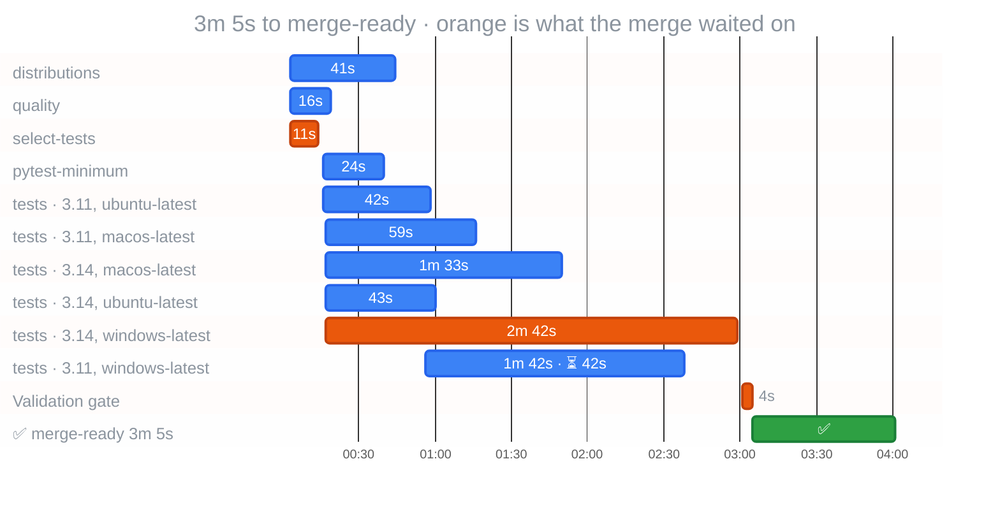

# Fix the measured critical path, not just the CI plumbing

Selective #32 moved an existing native Git optimization into CI-esta. It did not
speed up test execution. Its observed regression was Windows pytest 160 → 186s,
checkout 5 → 16s, and environment setup 10 → 18s. Those measurements cannot
attribute every second of runner variation to the action move.

This follow-up keeps temporary repositories on the runner work disk and uses
`git init --template=` for fixtures, avoiding hundreds of copies of unused Git
sample hooks. All platform/Python lanes, real commits, coverage, minimum-pytest
compatibility and the executable tutorial remain required.

## Fresh hosted control and after

| Measurement | Unchanged control | Optimized | Difference |
| --- | ---: | ---: | ---: |
| Windows Python 3.11 pytest step | 187s | 73s | −61.0% |
| Windows Python 3.14 pytest step | 185s | 115s | −37.8% |
| Validation gate elapsed | 249s | 185s | −25.7% |
| Dependency critical-path execution | 242s | 177s | −26.9% |
| Sum of all job execution | 740 runner-seconds | 597 runner-seconds | −19.3% |

The critical path remains `select-tests → Windows tests → Validation gate`.
The longest Windows variant changes from Python 3.11 to 3.14. Runner-seconds
are a sum of job durations, not elapsed time or billed minutes.

Sources, both attempt 1:

- [Fresh unchanged control, run 39919567540](https://github.com/gigaverse-app/pytest-selective/actions/runs/39919567540),
  head `4301c88e440b60f514c94f1bf32a025322ba2ad2`.
- [Optimized run 39919114589](https://github.com/gigaverse-app/pytest-selective/actions/runs/39919114589),
  head `d142f5af4d836f308140e923d4e66cc895f518b0`.

The control was dispatched after the optimized run, rather than choosing only
the earlier slow run. The [earlier unchanged run](https://github.com/gigaverse-app/pytest-selective/actions/runs/39915035279)
took 391s to the gate, with 258s/330s Windows test steps. That variation is why
the smaller fresh-control comparison is the headline. These are observed runs,
not a guaranteed percentage or a statistically isolated attribution between
the two filesystem changes. A local Windows template-only experiment measured
63.52s before and 64.41s after, so it showed no local speedup by itself.

## Conformance evidence

Both Windows versions retain all 626 original JUnit cases and their outcomes.
Each adds one passing test proving that minimal templates still produce real,
independent commit histories. Python 3.11 retains its platform-specific skips;
Python 3.14 retains its own baseline skip set. Coverage remains enabled.

[Raw CI-esta reports and JUnit files](2026-10-23-windows-saleor/) preserve the
run/head/attempt identities, DAG edges, timestamps, slack, and case inventories.
CI-esta computes the dependency path from the workflow DAG; it does not call the
longest individual step the entire critical path.

## Apply the optimization

Set temporary paths on the pytest **step**, where the runner context is valid:

```yaml
- run: uv run --locked pytest -q -n 4 --cov --junitxml=test-timings.xml
  env:
    TMP: ${{ runner.temp }}
    TEMP: ${{ runner.temp }}
    TMPDIR: ${{ runner.temp }}
```

Keep the matrix and full case inventory, collect before/after JUnit and job/step
reports, and repeat a control on the original revision. Do not disable security
software, mock Git, or drop coverage to make the graph look better. See
[CI-esta's portable recipes](https://github.com/gigaverse-app/ci-esta/blob/main/docs/critical-path-optimizations.md)
for database client matching and profiling recovery tests.

## Observed optimized workflow timeline



Orange follows the actual `needs` graph. Bars are observed API timestamps,
normalized to workflow creation; gaps include runner/admission delay.
