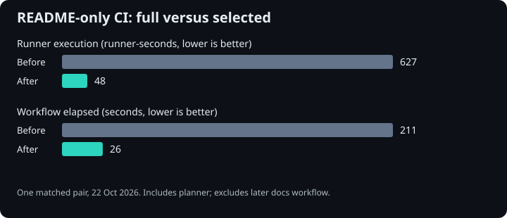

# Run the tests your edit affects

Change one Python function and run the tests that depend on it. pytest-selective follows the change through your code, so you can catch a regression in a caller without waiting for the whole suite.

Free and open source under Apache 2.0. Use it locally with your existing pytest suite or add it to CI.

## Try it on your next edit

In a project with a passing pytest suite, install the plugin:

```sh
uv add --dev pytest-selective
```

Commit the dependency and lockfile changes. Edit an application function, then run:

```sh
uv run pytest --selective
```

Read the selection summary to see which files your edit affected. The selector follows indirect imports too. If scope is uncertain, it runs the full suite. Use `uv run pytest --no-selective` for a full comparison.

In CI you can move selection ahead of collection and service startup. A documentation edit can then skip a database job before you pay to start its runner.

## Add it to CI with one prompt

Paste this into your coding agent from the root of your repository:

```text
Set up pytest-selective in this repository. Fetch https://pytest-selective.readthedocs.io/en/latest/agent-setup.md and follow it.
```

Your agent opens a pull request with the workflow changes and measurements. You can review which checks ran, how long you waited, and how much runner time they used.

[Quickstart](https://pytest-selective.readthedocs.io/en/latest/docs/tutorial/){ .md-button .md-button--primary } [Adoption guide](https://pytest-selective.readthedocs.io/en/latest/docs/tutorials/adoption-checklist/){ .md-button }

## How much time could you save?

On pytest-obligation, editing its README took **20 seconds** to check instead of **6 minutes**, using **97% less runner time**. Editing a MongoDB test still ran the relevant checks and finished in **54 seconds** instead of **5m22s**. [Explore the measured examples](https://pytest-selective.readthedocs.io/en/latest/ecosystem/).


