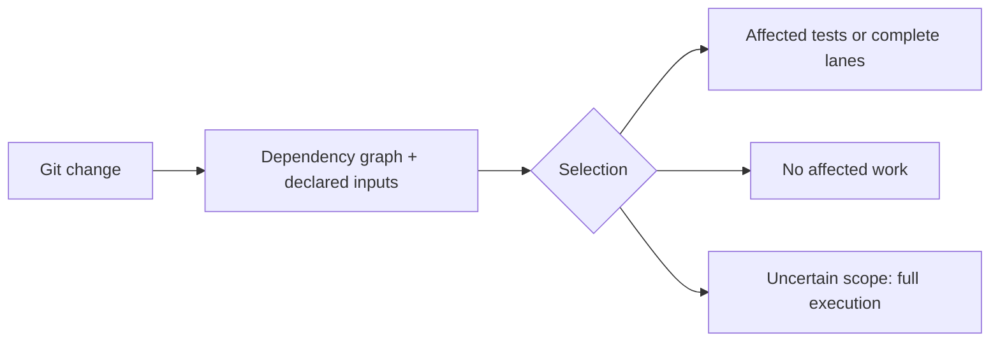
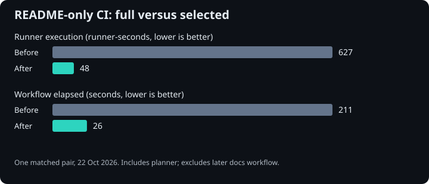

# Run the tests your Python change can affect.

pytest-selective follows Python dependencies across Git revisions, explains why
each test was selected, and falls back to full execution when scope cannot be
established. Use it for the local edit/test loop or to skip entire unrelated CI
lanes before services and runners start.

[Try it in your project](../docs/tutorial.md){ .md-button .md-button--primary }
[Skip unrelated CI jobs](../docs/tutorials/skip-unrelated-ci.md){ .md-button }

## Start locally

In an existing Git-backed Python project with a passing pytest suite:

```bash
uv add --dev pytest-selective
# Commit the dependency change, then edit application code.
uv run pytest --selective
# Keep a full-suite checkpoint:
uv run pytest --no-selective
```

Python 3.11+ and Git 2.24+ are required. Native mode compares HEAD with staged,
unstaged and nonignored untracked changes. It collects normally, then deselects
unaffected tests. Use a known passing branch base for committed changes. The
[tutorial](../docs/tutorial.md) covers the first run and a controlled regression.



## Pick the right level

| Your bottleneck | Start here |
| --- | --- |
| Repeating local tests after each edit | [Native pytest plugin](../docs/local-development.md) |
| Importing and collecting a large suite | [Pre-collection runner](../docs/local-development.md#pre-collection-runner) |
| Starting databases and every OS lane for README changes | [Whole-lane tutorial](../docs/tutorials/skip-unrelated-ci.md) |
| Selection is unexpectedly broad | [Dependency explanations and audit](../docs/selection-health.md) |

Imports cannot reveal every file read, subprocess or external dependency. Declare
those inputs and keep full checkpoints. Conformance suites and whole-suite
coverage may need complete lanes. [Guarantees and limits](../docs/evidence.md).

## Measured, scenario-specific savings



One same-revision full/selected pair retained quality and package checks while
skipping unrelated test lanes. This is a historical workflow comparison, not a
universal speedup or a bill. [Runs, retained checks and measurement limits](../docs/benchmarks/2026-10-22-routing.md).

## Related tools and support

[Choose a related tool](ecosystem.md) when you also need test selection, CI
measurement or background-work guarantees. Each project works independently.

`latest` follows main and can contain APIs newer than your installed package.
Check the release notes for that version. [Report an issue](https://github.com/gigaverse-app/pytest-selective/issues)
with a minimal reproducer, or read [the contribution guide](../CONTRIBUTING.md).
